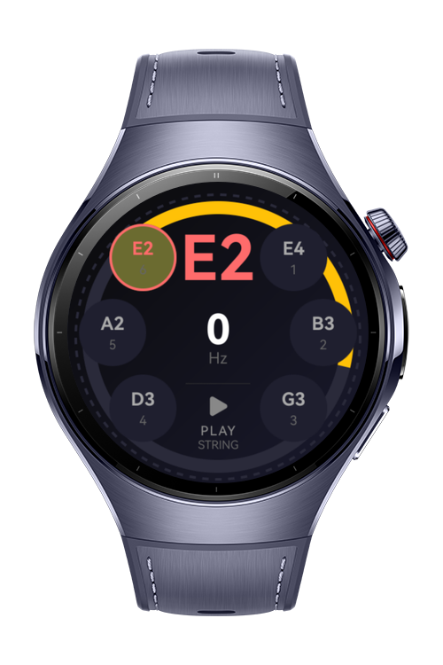
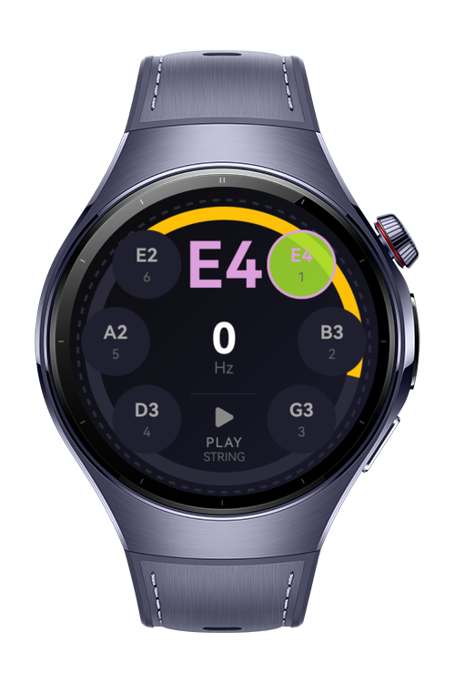
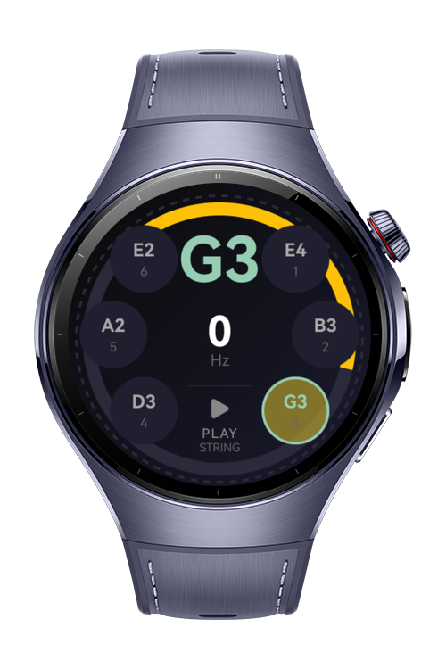

> **Note:** To access all shared projects, get information about environment setup, and view other guides, please visit [Explore-In-HMOS-Wearable Index](https://github.com/Explore-In-HMOS-Wearable/hmos-index).

# Guitar Tuner

A wearable guitar tuning application for HarmonyOS devices. Guitar Tuner helps musicians quickly and accurately tune their guitars using real-time audio frequency analysis on a smartwatch.

# Preview

<div>
  
  
  
</div>

# Use Cases

1. Tune a guitar before a live performance
2. Quickly check pitch during practice sessions
3. Verify tuning stability over time
4. Compare tuning across multiple guitars
5. Train ear with visual frequency feedback
6. Tune different string gauges
7. Help beginners learn standard tuning
8. Support alternate tunings (drop D, open G)
9. Diagnose string intonation issues
10. Provide vibration alerts when in tune
11. Use in noisy environments with robust frequency detection
12. Serve as a compact on-wrist tuning tool

- **Real-time Tuning**: Analyze guitar string frequencies in real-time
- **Fast Fourier Transform (FFT)**: Advanced audio signal processing for accurate frequency detection
- **User-friendly Interface**: Intuitive controls optimized for smartwatch displays
- **Wearable Experience**: Designed specifically for HarmonyOS wearable devices

# Technology

## Stack (Languages, Frameworks, Tools, Libraries, *3rd Party)

- **Languages**: ArkTS, TypeScript
- **UI Framework**: ArkUI
- **Platform**: HarmonyOS 5.1.0 (API 18)
- **IDE**: DevEco Studio 5.1.0.828 SP1

- **@kit.ArkUI**: UI component framework
- **@kit.MediaKit**: Audio recording and processing
- Custom FFT library for frequency analysis

## Required Permissions ( H2 )

- `ohos.permission.MICROPHONE` : Capture audio input for frequency detection
- `ohos.permission.VIBRATE` : Provide haptic feedback when strings are in tune

# Directory Structure

```
entry/src/main/ets/
├───libs/
│   └── fft.ets                    # Fast Fourier Transform implementation
├───pages/
│   └── Index.ets                  # Main tuner UI page
└───viewmodel/
    └── guitarTuner.ets            # Tuner logic and state management
```

# Constraints and Restrictions

## Supported Devices

- Huawei Watch 5 and compatible HarmonyOS wearable devices

## Limitations

- Application requires a physical device (not supported on emulator/simulator)
- Microphone permissions must be granted for audio input
- Best results with clear audio input environments

# License

**Guitar Tuner** is distributed under the terms of the MIT License.
See the [LICENSE](/LICENSE) for more information.
